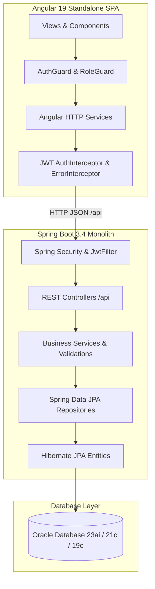

# StockSmart — Retail Inventory Management System

**StockSmart** is a complete, full-stack B.Tech academic project demonstrating modern enterprise retail inventory management.

The application is built as a clean **layered monolith** combining **Angular 19** on the frontend, **Spring Boot 3.4 (Java 21)** on the backend, and **Oracle Database** for relational persistence. It demonstrates role-based access control (RBAC), stateless JWT authentication, catalog master data management, multi-location stock movements, barcode lookup, purchase & sales workflows, inter-location transfers, automated low-stock alerts, and executive KPI reporting.

---

## 1. Architecture

The system implements a clean, demonstrable monolithic layered architecture without unnecessary distributed system or microservice complexity:



### Backend Layered Conventions
- **Controllers:** Expose plain JSON DTOs (`/api/...`). JPA entities are never leaked directly across REST boundaries.
- **Services:** Encapsulate business logic, validations (e.g. non-negative stock invariants), and transaction boundaries (`@Transactional`).
- **Repositories:** Standard Spring Data JPA interfaces.
- **Security:** Stateless JWT authentication with BCrypt password hashing.
- **Exception Handling:** Unified `@RestControllerAdvice` returning structured `ApiErrorResponse` JSON.

---

## 2. Technology Stack

| Layer | Technologies & Frameworks | Description |
|-------|---------------------------|-------------|
| **Frontend** | Angular 19, TypeScript, RxJS, HTML5, SCSS | Standalone component architecture, functional route guards, reactive forms, SVG data visualizers. |
| **Backend** | Java 21, Spring Boot 3.4 | Spring Web, Spring Security, Spring Data JPA, Hibernate, Jakarta Validation, Lombok. |
| **Security** | Spring Security 6, JJWT (io.jsonwebtoken) | Stateless Bearer JWT tokens, role-based method authorization (`@PreAuthorize`). |
| **Database** | Oracle Database (23ai Free / 21c / 19c) | Relational tables with foreign key constraints, composite unique indexes, and audit timestamps. |
| **Build Tools** | Maven (wrapper included), Node.js & npm | Reproducible backend and frontend build tooling. |

---

## 3. Repository Layout

```
StockSmart/
├── backend/                  # Spring Boot application
│   ├── src/main/java/        # Java source code (controllers, services, entities, DTOs, security, config)
│   ├── src/main/resources/   # Application YAML configs (application.yml, application-dev.yml)
│   ├── src/test/java/        # MockMvc JUnit 5 integration test suites
│   ├── pom.xml               # Maven project descriptor
│   └── mvnw.cmd / mvnw       # Maven wrapper binaries
├── frontend/                 # Angular 19 SPA
│   ├── src/app/core/         # Models, services, guards, and interceptors
│   ├── src/app/layout/       # Sidebar navigation and header shell layout
│   ├── src/app/pages/        # Feature components (Dashboard, Products, Inventory, Orders, etc.)
│   ├── src/environments/     # Environment configurations (API base URL)
│   ├── angular.json          # Angular CLI workspace configuration
│   └── package.json          # Frontend dependencies and npm scripts
├── docs/                     # Architectural diagrams, REST API specs, testing guide, database schema
└── README.md                 # Project guide, setup instructions, and reference
```

---

## 4. Setup & Running Instructions

### Prerequisites
- **Java Development Kit (JDK):** Version 17 or 21 installed and added to `PATH`.
- **Node.js:** Version 18.x or 20.x with npm installed.
- **Oracle Database:** Oracle 23ai Free, 21c XE, or 19c (or connection to a remote Oracle instance).

---

### Step 1: Database Setup
1. Start your Oracle Database instance.
2. Connect as `SYSDBA` or database administrator and create a schema user:
   ```sql
   CREATE USER stocksmart IDENTIFIED BY stocksmart;
   GRANT CONNECT, RESOURCE, DBA TO stocksmart;
   ```
3. Check connection properties in `backend/src/main/resources/application-dev.yml`:
   ```yaml
   spring:
     datasource:
       url: jdbc:oracle:thin:@localhost:1521/FREEPDB1
       username: stocksmart
       password: stocksmart
       driver-class-name: oracle.jdbc.OracleDriver
     jpa:
       hibernate:
         ddl-auto: update
       properties:
         hibernate:
           dialect: org.hibernate.dialect.OracleDialect
   ```
   *(Note: The backend includes Hikari connection timeout tolerance `initialization-fail-timeout: -1` so you can verify `/api/health` even before database initialization).*

---

### Step 2: Backend Application
Open a terminal in the project root:

```powershell
cd backend
.\mvnw.cmd spring-boot:run
```
*(Or if standard Maven is installed: `mvn spring-boot:run`)*

- Backend starts on: `http://localhost:8080`
- Health check endpoint: `http://localhost:8080/api/health`

---

### Step 3: Frontend Application
Open a second terminal:

```powershell
cd frontend
npm install
npm start
```

- Frontend starts on: `http://localhost:4200`
- The Angular dev server automatically proxies `/api` calls to `http://localhost:8080`.
- To create an optimized production build:
  ```powershell
  npm run build
  ```

---

## 5. Seed Demo Accounts & Catalog

When the application boots for the first time against an empty database, `DataInitializer` automatically seeds realistic demo data:

### Default User Credentials

| Username | Password | Role | Access Permissions |
|----------|----------|------|--------------------|
| `admin` | `Admin@123` | `ADMIN` | Full system access, User Administration (`/users`), Master Data CRUD, Workflow approvals. |
| `manager` | `Manager@123` | `INVENTORY_MANAGER` | Catalog management, Inventory movements & adjustments, Purchase Orders, Transfers, Alerts. |
| `staff` | `Staff@123` | `STAFF` | Point-of-Sale Sales Orders, Barcode scanning & stock lookup, Alert scanning, Read-only inventory. |

### Pre-Seeded Master Data & Demo Inventory
- **Categories:** `Electronics`, `Groceries`, `Stationery`, `Hardware & Tools`.
- **Locations:** `Central Warehouse` (Warehouse facility), `Downtown Retail Store` (Store outlet).
- **Suppliers:** `Apex Electronics Ltd`, `Metro Wholesale Distribution`.
- **Products with Barcodes:**
  - `Wireless Optical Mouse` (`ELEC-MOU-01`, Barcode `8901234567890`)
  - `Mechanical Gaming Keyboard` (`ELEC-KEY-02`, Barcode `8901234567891`)
  - `USB-C Fast Charging Cable 2m` (`ELEC-CBL-03`, Barcode `8901234567894`)
  - `A5 Ruled Hardcover Notebook` (`STAT-NBK-01`, Barcode `8901234567892`)
  - `Organic Green Tea (50 Bags)` (`GROC-TEA-01`, Barcode `8901234567893`)
  - `Precision Screwdriver Set 32-in-1` (`HARD-SCR-01`, Barcode `8901234567895`)
- **Initial Inventory Balances:** Fully stocked quantities at the Central Warehouse, alongside low-stock and out-of-stock items at Downtown Retail Store to demonstrate live alerts and KPI distribution immediately.

---

## 6. Functional Modules Overview

### 1. Executive Operations Dashboard (`/`)
- Real-time operational KPI cards: Total Active Products, Total Stock Units, Inventory Valuation ($), Active Alerts, Pending POs, and Customer Sales Orders.
- Location and Category distribution breakdown with visual status bars.
- Live quick-launchpad tiles and recent inventory transaction feed.

### 2. Catalog & Master Data Management
- **Categories (`/categories`):** Parent-child category hierarchy management.
- **Products (`/products`):** SKU uniqueness, unit retail pricing, category association, and barcode mapping.
- **Locations (`/locations`):** Store branches and warehouse distribution centers.
- **Suppliers & Catalog Linking (`/suppliers`):** Vendor directory with interactive product procurement pricing (`SupplierProduct` unit cost linking).

### 3. Inventory Core & Movement Tracking (`/inventory`)
- **Barcode Scanner Widget:** Instant lookup by barcode or SKU returning total available stock and per-location quantity breakdown.
- **Stock In:** Restock inventory and log audit movement.
- **Stock Out:** Dispatch items with strict non-negative stock validation.
- **Physical Count Adjustment:** Reconcile cycle counts with audit trail reason notes.
- **Reorder Thresholds:** Configurable low-stock alert triggers per location.
- **Live Audit Trail:** Complete transaction log history (`INVENTORY_TRANSACTIONS`).

### 4. Procurement & Workflow Operations
- **Purchase Orders (`/purchase-orders`):** Multi-item supplier purchase orders. Receiving a PO automatically increments destination warehouse stock and updates status to `RECEIVED`.
- **Sales Orders (`/orders`):** Customer order placement with line item subtotaling. Fulfilling an order validates inventory and decrements stock.
- **Stock Transfers (`/stock-transfers`):** Inter-location stock transfers with atomic source deduction and destination credit.

### 5. Alerts Center (`/alerts`)
- Automated detection of `LOW_STOCK` (quantity <= reorder level) and `OUT_OF_STOCK` (quantity = 0).
- One-click **Run Reorder Scan** to analyze all product-location balances.
- Status management: `ACTIVE`, `ACKNOWLEDGED`, and `RESOLVED`.

### 6. Valuation Reporting (`/reports`)
- Real-time asset valuation reports computed as `Quantity × Unit Price = Total Value`.
- Multi-facet filters by Location, Category, and text query with exportable summaries.

### 7. User Administration (`/users`)
- Accessible exclusively by `ADMIN`.
- Create, update, assign roles, and soft-deactivate system accounts.

---

## 7. REST API Endpoints Summary

Base path: `/api`

| Module | Method & Path | Description | Access Role |
|--------|---------------|-------------|-------------|
| **Auth** | `POST /api/auth/login` | Authenticate and obtain JWT token | Public |
| | `POST /api/auth/register` | Self-register as STAFF | Public |
| | `GET /api/auth/me` | Fetch active profile & roles | Authenticated |
| **Users** | `GET /api/users` | List system users | `ADMIN` |
| | `POST /api/users` | Create user with role | `ADMIN` |
| | `PUT /api/users/{id}` | Update user details & role | `ADMIN` |
| | `DELETE /api/users/{id}` | Deactivate user | `ADMIN` |
| **Categories** | `GET /api/categories` | List all categories | Authenticated |
| | `POST /api/categories` | Create category | `ADMIN`, `INVENTORY_MANAGER` |
| **Products** | `GET /api/products` | List all products | Authenticated |
| | `GET /api/products/barcode/{barcode}` | Barcode lookup | Authenticated |
| | `POST /api/products` | Create product | `ADMIN`, `INVENTORY_MANAGER` |
| **Locations** | `GET /api/locations` | List warehouse and store locations | Authenticated |
| | `POST /api/locations` | Create location | `ADMIN`, `INVENTORY_MANAGER` |
| **Suppliers** | `GET /api/suppliers` | List suppliers | Authenticated |
| | `GET /api/suppliers/{id}/products` | Get linked supplier catalog | Authenticated |
| | `POST /api/suppliers/{id}/products` | Link product with unit cost | `ADMIN`, `INVENTORY_MANAGER` |
| **Inventory** | `GET /api/inventory` | Inventory balances (with filters) | Authenticated |
| | `GET /api/inventory/barcode/{code}` | Cross-location stock breakdown | Authenticated |
| | `POST /api/inventory/stock-in` | Restock inventory | `ADMIN`, `INVENTORY_MANAGER` |
| | `POST /api/inventory/stock-out` | Dispatch stock | Authenticated |
| | `POST /api/inventory/adjust` | Physical count adjustment | `ADMIN`, `INVENTORY_MANAGER` |
| | `GET /api/inventory/transactions` | Transaction audit log | Authenticated |
| **Workflows** | `POST /api/purchase-orders` | Create purchase order | `ADMIN`, `INVENTORY_MANAGER` |
| | `POST /api/purchase-orders/{id}/receive` | Receive PO & add stock | `ADMIN`, `INVENTORY_MANAGER` |
| | `POST /api/orders` | Create customer order | Authenticated |
| | `POST /api/orders/{id}/confirm` | Fulfill order & deduct stock | Authenticated |
| | `POST /api/transfers` | Create stock transfer | `ADMIN`, `INVENTORY_MANAGER` |
| | `POST /api/transfers/{id}/complete` | Complete transfer between locations | `ADMIN`, `INVENTORY_MANAGER` |
| **Alerts** | `GET /api/alerts` | List system alerts | Authenticated |
| | `POST /api/alerts/check` | Trigger reorder level scan | Authenticated |
| | `POST /api/alerts/{id}/acknowledge`| Acknowledge alert | `ADMIN`, `INVENTORY_MANAGER` |
| | `POST /api/alerts/{id}/resolve` | Resolve alert | `ADMIN`, `INVENTORY_MANAGER` |
| **Dashboard** | `GET /api/dashboard/summary` | Executive operational KPIs | Authenticated |
| **Reports** | `GET /api/reports/valuation` | Detailed asset valuation report | Authenticated |

*(Full request/response DTO schemas and details are documented in [docs/api.md](./docs/api.md)).*

---

## 8. Documentation Directory

Further academic project documentation and diagrams are located in [`docs/`](./docs/):
- **[Architecture Overview (`docs/architecture.md`)](./docs/architecture.md):** High-level component diagrams and tier descriptions.
- **[Database Schema & ERD (`docs/database.md`)](./docs/database.md):** Complete database table layouts, field types, and entity relationships.
- **[REST API Reference (`docs/api.md`)](./docs/api.md):** Detailed API contracts, status codes, and JSON schemas.
- **[Manual Testing & Viva Checklist (`docs/testing.md`)](./docs/testing.md):** 13-point test plan and requirements traceability matrix for presentation.
- **[Security Design (`docs/security.md`)](./docs/security.md):** JWT token lifecycle and role guard enforcement.
- **[Sequence Diagrams (`docs/sequence-diagrams.md`)](./docs/sequence-diagrams.md):** Interaction diagrams for key workflows (Login, PO Receipt, Order Fulfillment, Stock Transfer).
- **[Class Diagram (`docs/class-diagram.md`)](./docs/class-diagram.md):** Entity and service relationship diagrams.

---

## 9. Design Principles & College Monolith Scope

To ensure high clarity, maintainability, and clean academic evaluation:
- **Keep it Simple:** Monolithic layered structure (`Controller → Service → Repository → Entity → Database`).
- **No Microservices or Message Queues:** Direct synchronous service calls avoid unnecessary complexity (no Kafka, Redis, or Docker clusters required).
- **Explicit Invariant Validation:** Business rules like non-negative inventory are enforced in the Java service layer with descriptive error messages.
- **Modern Angular Standards:** Angular 19 standalone components without legacy `NgModule` boilerplate, utilizing reactive forms, HTTP interceptors, and strict TypeScript typing.
