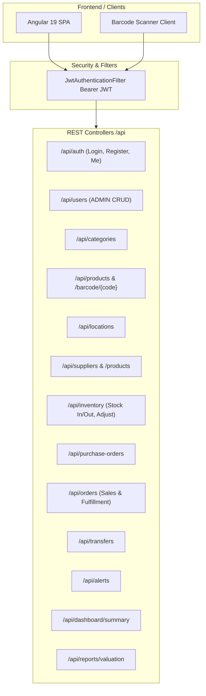

# StockSmart REST API Documentation

> **College Project Monolith Scope:** Implemented endpoints use base path **`/api`** (configured via Angular proxy and Spring Boot). Responses are **plain DTOs and arrays** (clean JSON representation without unnecessary envelope wrappers). Security is powered by stateless **JWT Bearer authentication** with three roles: `ADMIN`, `INVENTORY_MANAGER`, and `STAFF`.

---

## Architecture Overview



---

## Common Error Response

Validation and business exceptions return a structured JSON response handled globally by `GlobalExceptionHandler`:

```json
{
  "status": 400,
  "message": "Insufficient stock available for product Wireless Mouse at Central Warehouse",
  "errors": [],
  "timestamp": "2026-10-30T10:00:00Z"
}
```

---

## 1. Authentication (`/api/auth`)

Public and self-service authentication endpoints.

### `POST /api/auth/login`
- **Roles**: Public
- **Request Body**:
  ```json
  { "username": "admin", "password": "Admin@123" }
  ```
- **Response (200 OK)**:
  ```json
  {
    "accessToken": "eyJhbGciOi...",
    "tokenType": "Bearer",
    "expiresInMs": 3600000,
    "username": "admin",
    "fullName": "System Admin",
    "roles": ["ADMIN"]
  }
  ```

### `POST /api/auth/register`
- **Roles**: Public (registers as `STAFF`)
- **Request Body**: `username`, `email`, `password`, `firstName`, `lastName`
- **Response (201 Created)**: Returns `AuthResponse` with JWT token.

### `GET /api/auth/me`
- **Roles**: Any authenticated user
- **Response (200 OK)**: Current user's profile and assigned roles.

---

## 2. User Administration (`/api/users`)

Manage system users and access roles.

- **Roles**: `ADMIN` only
- `GET /api/users` — List all users
- `GET /api/users/{id}` — Retrieve user by ID
- `POST /api/users` — Create user (`username`, `email`, `password`, `firstName`, `lastName`, `role`)
- `PUT /api/users/{id}` — Update user details and role
- `DELETE /api/users/{id}` — Soft deactivation (`active = false`)

---

## 3. Categories (`/api/categories`)

Product categorization tree.

- **Read**: Authenticated (`ADMIN`, `INVENTORY_MANAGER`, `STAFF`)
- **Write**: `ADMIN`, `INVENTORY_MANAGER`
- `GET /api/categories` — List categories ordered by name
- `GET /api/categories/{id}` — Category details
- `POST /api/categories` — Create category (`name`, optional `parentId`)
- `PUT /api/categories/{id}` — Update category name/parent
- `DELETE /api/categories/{id}` — Delete category (fails if child categories exist)

---

## 4. Products (`/api/products`)

Catalog items with SKUs and Barcodes.

- **Read**: Authenticated
- **Write**: `ADMIN`, `INVENTORY_MANAGER`
- `GET /api/products` — List all products
- `GET /api/products/{id}` — Product details
- `GET /api/products/barcode/{barcode}` — Lookup single product by barcode string
- `POST /api/products` — Create product (`name`, `sku`, `barcode`, `description`, `unitPrice`, `categoryId`)
- `PUT /api/products/{id}` — Update product details
- `DELETE /api/products/{id}` — Delete product

---

## 5. Locations (`/api/locations`)

Physical warehouses and retail store branches.

- **Read**: Authenticated
- **Write**: `ADMIN`, `INVENTORY_MANAGER`
- `GET /api/locations` — List all locations
- `GET /api/locations/{id}` — Location details
- `POST /api/locations` — Create location (`name`, `type`: `STORE` | `WAREHOUSE`, `address`)
- `PUT /api/locations/{id}` — Update location
- `DELETE /api/locations/{id}` — Delete location

---

## 6. Suppliers & Catalog Linking (`/api/suppliers`)

Vendor directories and product procurement costs.

- **Read**: Authenticated
- **Write**: `ADMIN`, `INVENTORY_MANAGER`
- `GET /api/suppliers` — List suppliers
- `GET /api/suppliers/{id}` — Supplier details
- `POST /api/suppliers` — Create supplier (`name`, `contactName`, `email`, `phone`, `address`)
- `PUT /api/suppliers/{id}` — Update supplier
- `DELETE /api/suppliers/{id}` — Delete supplier
- `GET /api/suppliers/{id}/products` — Get linked products and unit costs
- `POST /api/suppliers/{id}/products` — Link product to supplier (`productId`, `unitCost`)
- `DELETE /api/suppliers/{id}/products/{productId}` — Remove supplier-product link
- `GET /api/products/{productId}/suppliers` — List suppliers supplying a specific product

---

## 7. Inventory Core (`/api/inventory`)

Stock levels, movements, barcode breakdown, and audit log.

- `GET /api/inventory?locationId={id}&query={search}` — List inventory items with stock status
- `GET /api/inventory/barcode/{barcode}` — Barcode lookup with breakdown across all locations
- `POST /api/inventory/stock-in` — Inward stock movement (`productId`, `locationId`, `quantity`, `referenceId`, `reason`)
- `POST /api/inventory/stock-out` — Outward stock movement with non-negative validation (`productId`, `locationId`, `quantity`, `referenceId`, `reason`)
- `POST /api/inventory/adjust` — Physical inventory cycle count adjustment (`productId`, `locationId`, `physicalQuantity`, `reason`)
- `PUT /api/inventory/reorder-level` — Set low stock alert threshold (`productId`, `locationId`, `reorderLevel`)
- `GET /api/inventory/transactions?productId={id}&locationId={id}&limit=50` — Movement audit trail

---

## 8. Purchase Orders (`/api/purchase-orders`)

Vendor procurement lifecycle.

- **Roles**: `ADMIN`, `INVENTORY_MANAGER`
- `GET /api/purchase-orders` — List POs
- `GET /api/purchase-orders/{id}` — PO details with line items
- `POST /api/purchase-orders` — Create PO (`supplierId`, `locationId`, `items`: `[ { productId, quantity, unitCost } ]`)
- `POST /api/purchase-orders/{id}/receive` — Receive PO items into inventory (increments stock at target location)
- `POST /api/purchase-orders/{id}/cancel` — Cancel pending PO

---

## 9. Sales Orders & Fulfillment (`/api/orders`)

Customer retail orders and inventory deduction.

- **Roles**: All authenticated roles (`ADMIN`, `INVENTORY_MANAGER`, `STAFF`)
- `GET /api/orders` — List customer sales orders
- `GET /api/orders/{id}` — Order details with line items
- `POST /api/orders` — Create sales order (`customerName`, `locationId`, `items`: `[ { productId, quantity } ]`)
- `POST /api/orders/{id}/confirm` — Fulfill and complete order (validates sufficient stock and decrements inventory)
- `POST /api/orders/{id}/cancel` — Cancel pending order

---

## 10. Inter-Location Transfers (`/api/transfers`)

Stock balancing between warehouses and stores.

- **Roles**: `ADMIN`, `INVENTORY_MANAGER`
- `GET /api/transfers` — List transfer requests
- `GET /api/transfers/{id}` — Transfer details with item quantities
- `POST /api/transfers` — Create transfer (`sourceLocationId`, `destinationLocationId`, `items`: `[ { productId, quantity } ]`)
- `POST /api/transfers/{id}/complete` — Complete transfer (atomically decrements source and increments destination)
- `POST /api/transfers/{id}/cancel` — Cancel pending transfer

---

## 11. Alerts & Reorder Level Monitoring (`/api/alerts`)

Real-time stock anomaly detection.

- **Roles**: `ADMIN`, `INVENTORY_MANAGER`, `STAFF`
- `GET /api/alerts?status={ACTIVE|ACKNOWLEDGED|RESOLVED}` — List alerts
- `POST /api/alerts/{id}/acknowledge` — Mark alert acknowledged
- `POST /api/alerts/{id}/resolve` — Mark alert resolved
- `POST /api/alerts/check` — Execute reorder scan across all product-location balances

---

## 12. Dashboard & Valuation Reporting

Executive summary and analytics.

- **Roles**: Authenticated
- `GET /api/dashboard/summary` — Returns real-time metrics:
  - Total Products, Locations, Suppliers
  - Total Stock Units & Total Valuation ($)
  - Low Stock Count & Out of Stock Count
  - Pending Purchase Orders & Customer Orders
  - Location stock distribution breakdown
  - Category stock distribution breakdown
  - Recent audit log transactions
- `GET /api/reports/valuation?categoryId={id}&locationId={id}` — Detailed inventory asset valuation report with per-product calculations and totals
