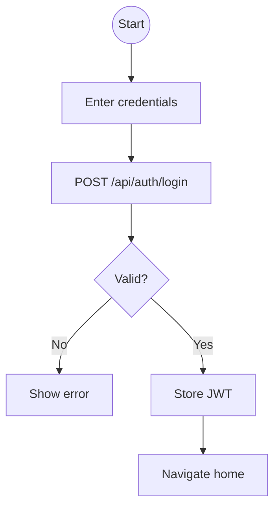
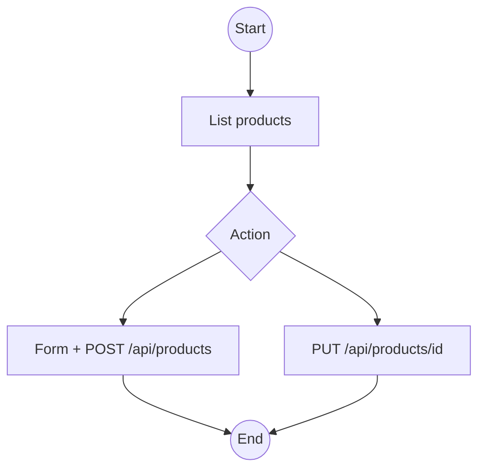
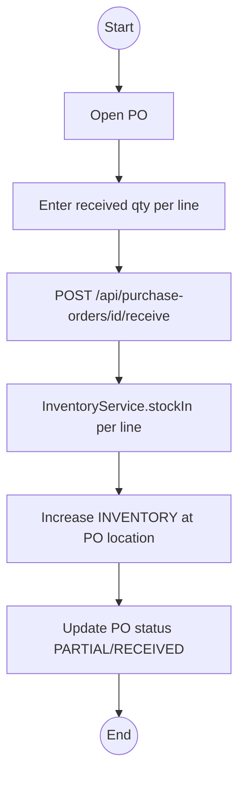
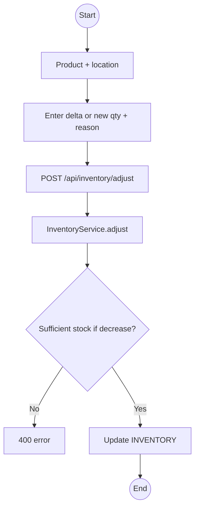
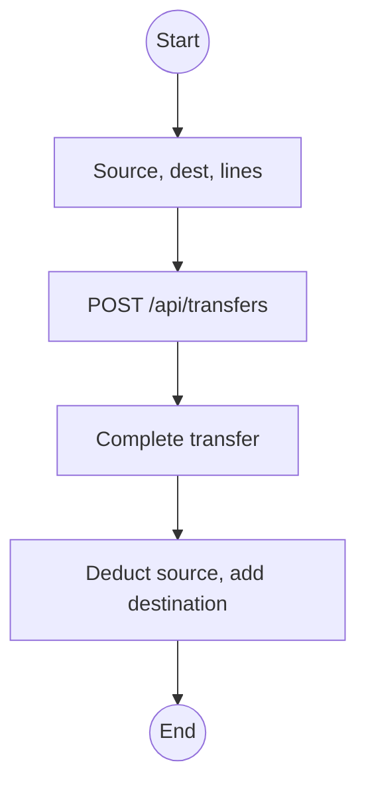
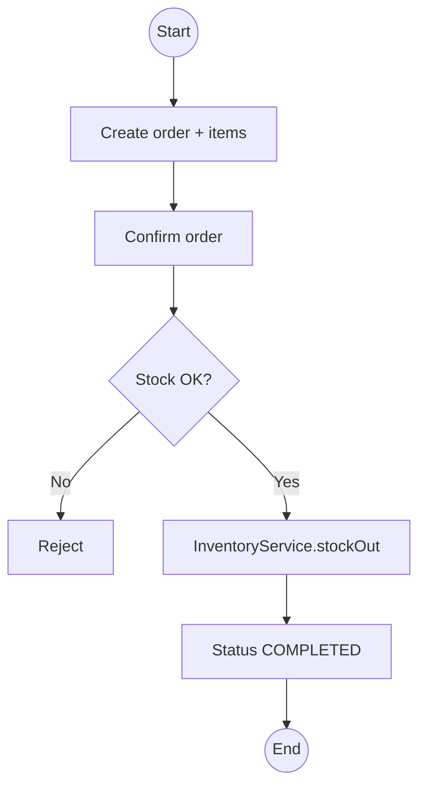
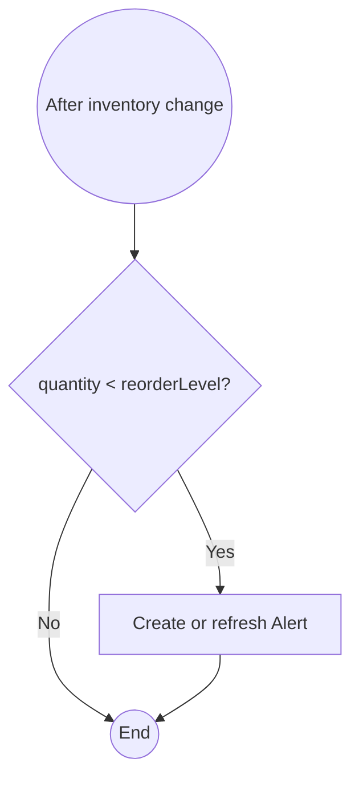
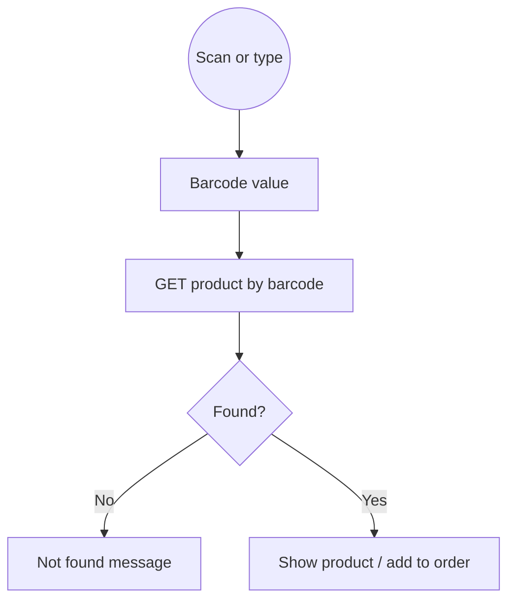
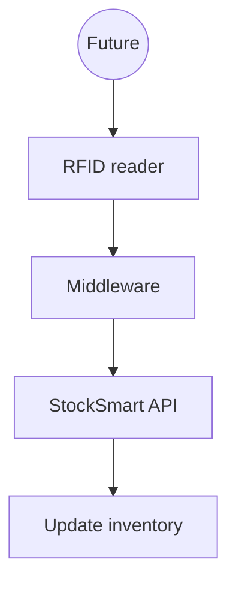
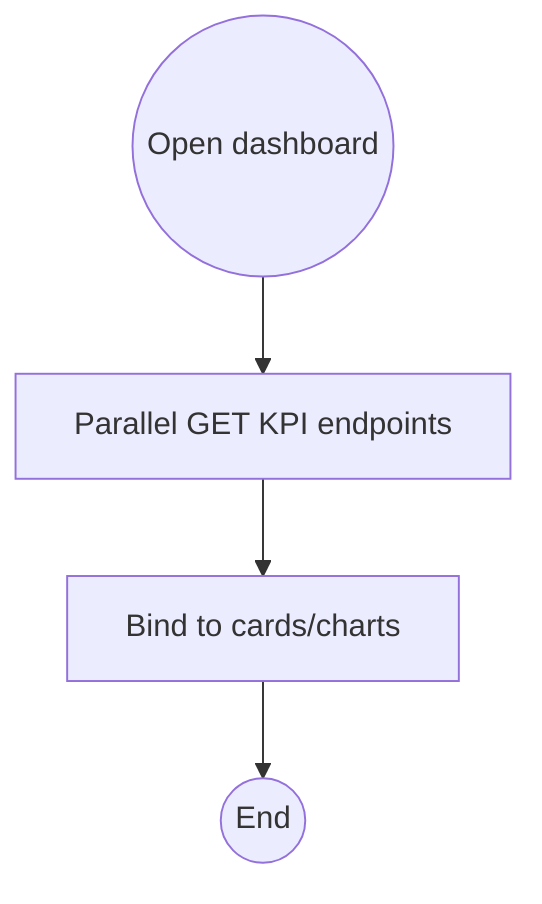

# StockSmart — Application Flow

Core workflows for the **college-level** implementation. Inventory changes run through **InventoryService** (update `INVENTORY.quantity`, optional `INVENTORY_TRANSACTION` row).

## 1. Application startup

```mermaid
flowchart TD
    Start((Start)) --> Init[Bootstrap Angular]
    Init --> Token{JWT present?}
    Token -->|Yes| Load[Load user / dashboard]
    Token -->|No| Login[/login]
```

## 2. Login



## 3. Admin user management

`ADMIN` opens `/users`. The Angular `roleGuard` blocks other roles. APIs live under `/api/users`.

```mermaid
flowchart TD
    Start((Admin signed in)) --> Page[/users]
    Page --> List[GET /api/users]
    List --> Action{Action}
    Action --> Create[POST /api/users]
    Action --> Edit[PUT /api/users/id]
    Action --> Deactivate[DELETE /api/users/id]
    Create --> End((End))
    Edit --> End
    Deactivate --> Inactive[IS_ACTIVE = 0]
    Inactive --> End
```

## 4. Category management

`ADMIN` and `INVENTORY_MANAGER` open `/categories`. STAFF may call `GET /api/categories` but has no menu link.

```mermaid
flowchart TD
    Start((Manager signed in)) --> Page[/categories]
    Page --> List[GET /api/categories]
    List --> Action{Action}
    Action --> Create[POST /api/categories]
    Action --> Edit[PUT /api/categories/id]
    Action --> Delete[DELETE /api/categories/id]
    Create --> End((End))
    Edit --> End
    Delete --> End
```

## 5. Product management



Include **barcode** on create/edit; validate uniqueness.

## 6. PO receive → stock in



## 7. Stock adjustment



## 8. Stock transfer



Optional two-step (PENDING → COMPLETED) — document chosen approach in implementation.

## 9. Sales order



No payment gateway in MVP.

## 10. Low-stock detection



## 11. Barcode lookup



No GS1 parsing step.

## 12. RFID (future — diagram only)



Not implemented in MVP — see [barcode-rfid.md](./barcode-rfid.md).

## 13. KPI dashboard load



See [kpi-reporting.md](./kpi-reporting.md).
