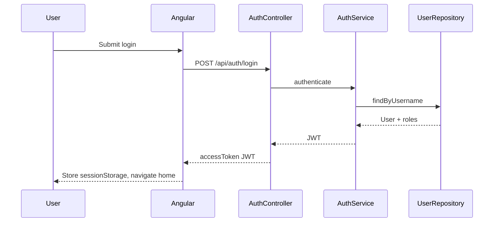
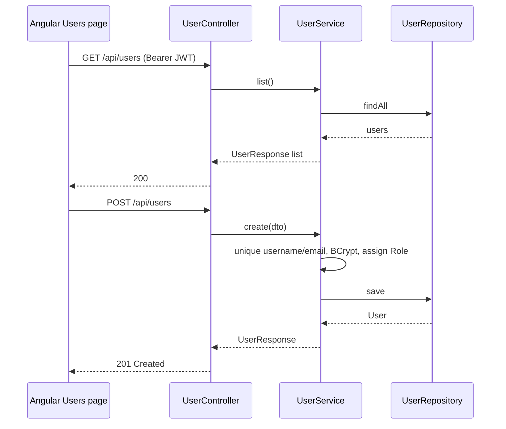
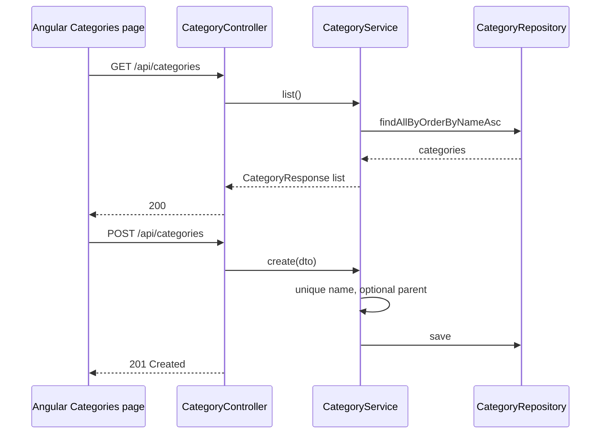
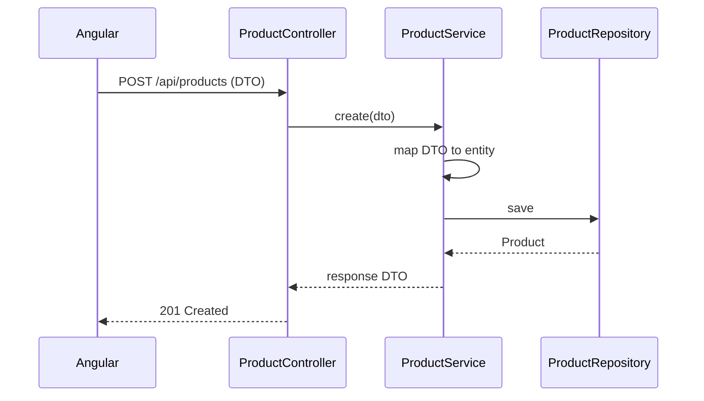
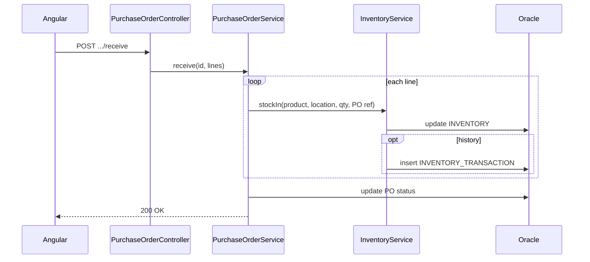
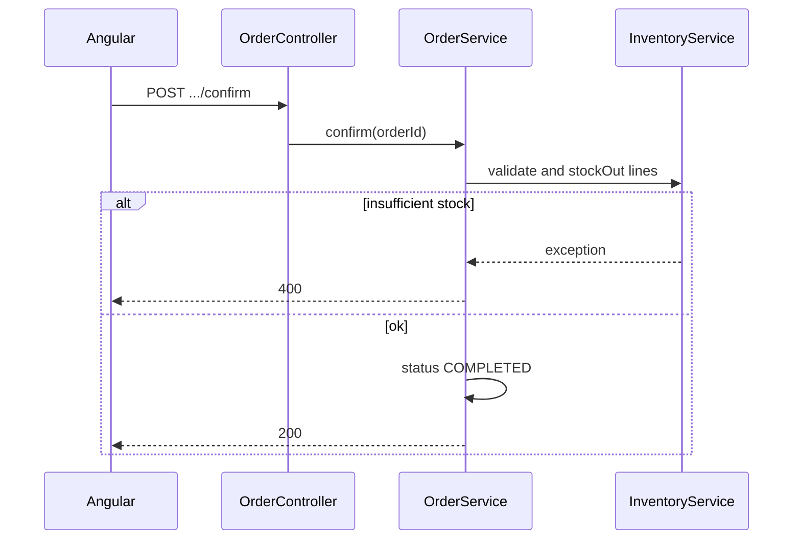
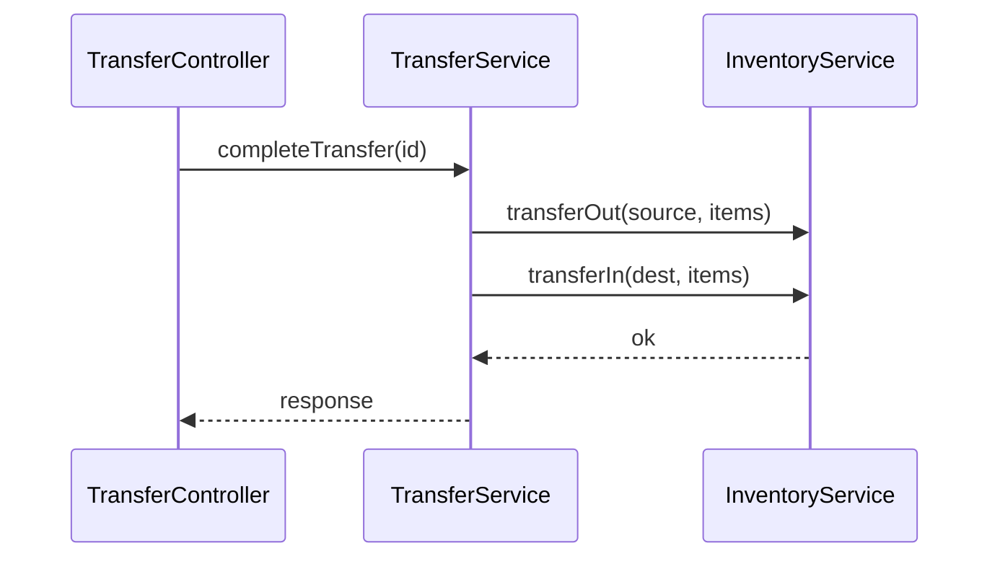
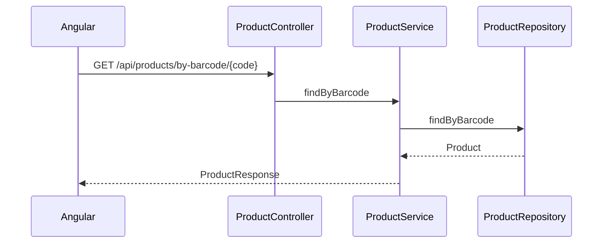
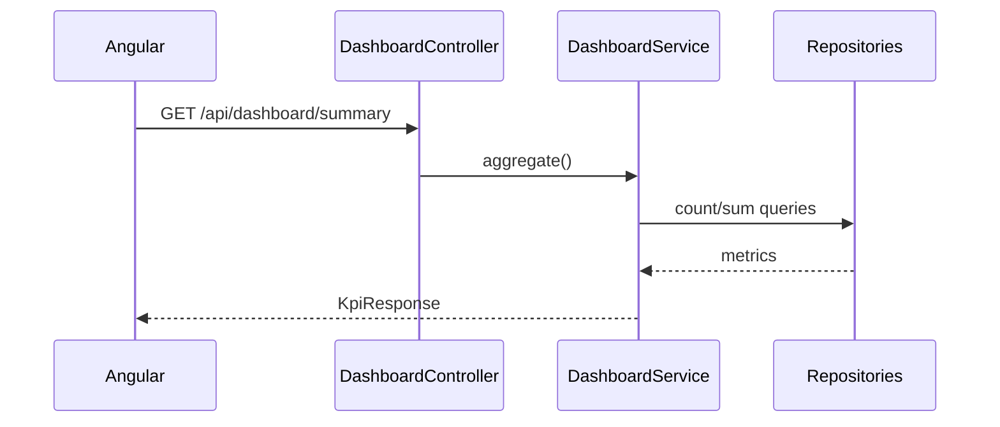

# StockSmart Sequence Diagrams

Key interactions for the **layered monolith** design (Controller → Service → Repository → Oracle).

---

## 1. Login

Logout is **client-only** (clear `access_token` / `auth_user`). There is no `POST /api/auth/refresh` or `POST /api/auth/logout`.

---

## 2. Admin user management

Implemented: `UserController` (`/api/users`) is **ADMIN-only**. Role is set on create/update (one role per user). `DELETE` deactivates the account; it does not hard-delete the row.

---

## 3. Category CRUD

Implemented: `CategoryController` (`/api/categories`). Read: any authenticated role. Write: `ADMIN` or `INVENTORY_MANAGER`.

---

## 4. Create product

---

## 5. Receive purchase order

---

## 6. Confirm sales order

---

## 7. Stock transfer

---

## 8. Barcode lookup

---

## 9. Dashboard KPI

---

## Removed from enterprise sequence doc

- InventoryLedgerService, MapStruct mapper step, OptimisticLockException retry, GS1 parse step, EPCIS ingestion, RFC 7807 envelope details
